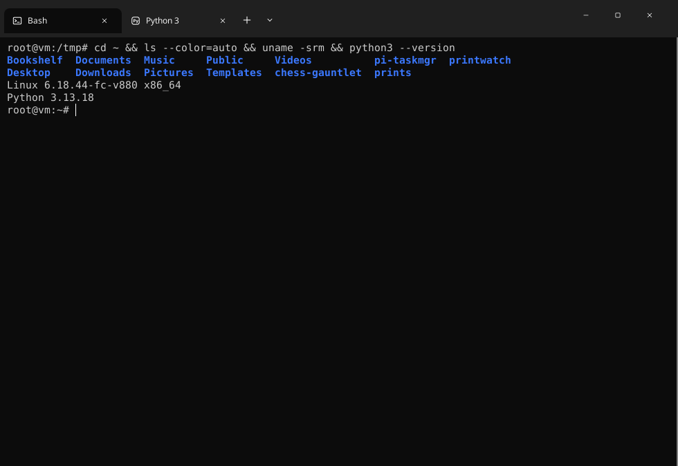
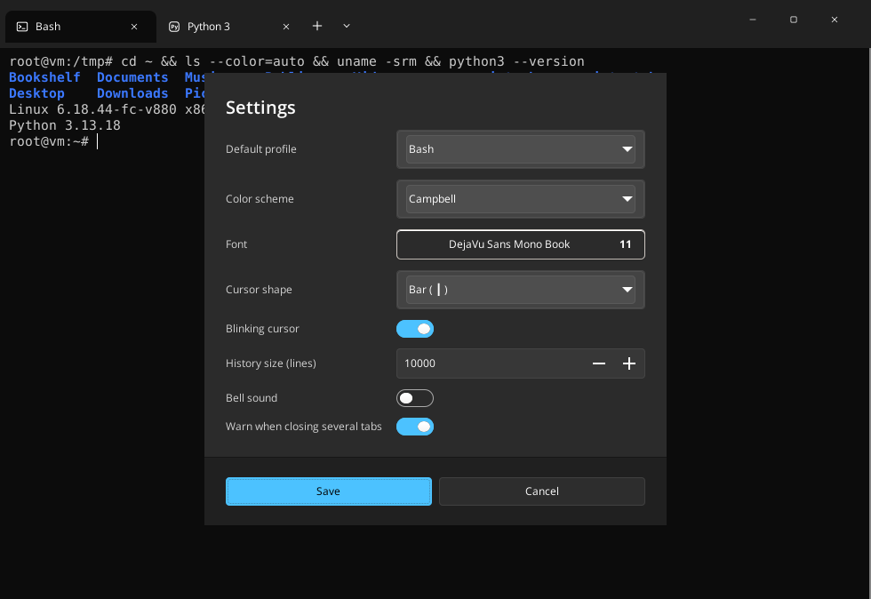

# pi-terminal

A Windows Terminal style Terminal app for the Raspberry Pi (built for the Pi 5, works on other Pis running Raspberry Pi OS). Native GTK app with the Windows 11 dark look, made to match [pi-explorer](https://github.com/wvfouram/pi-explorer) and [pi-taskmgr](https://github.com/wvfouram/pi-taskmgr).



## Features

- **Tabs** in the title bar, with a **profile dropdown** next to the + button: Bash, Python 3, Root shell and Raspberry Pi config
- New tabs open in the same folder as the current tab
- **Color schemes**: Campbell (the Windows Terminal default), One Half Dark, Tango Dark, Solarized Dark, Vintage and Raspberry
- **Settings** (Ctrl+,): default profile, color scheme, font, cursor shape, blinking cursor, history size, bell
- Ctrl+C copies when text is selected (otherwise it stops the running program, as usual); Ctrl+V pastes
- **Find** (Ctrl+Shift+F), zoom (Ctrl+wheel, Ctrl+plus/minus/0), rename and duplicate tabs, full screen (F11)
- Right-click menu with copy, paste, find and **Open folder in File Explorer**
- Warns before closing a tab that is still running a program



## Install

In a terminal on the Pi (as your normal user, not with sudo):

```
git clone https://github.com/wvfouram/pi-terminal.git && bash pi-terminal/install.sh
```

Then open **Terminal** from the menu, or run `pi-terminal`.

To update later:

```
cd ~/pi-terminal && git pull && bash install.sh
```

## Keyboard shortcuts

| Keys | Action |
|---|---|
| Ctrl+Shift+T | New tab |
| Ctrl+Shift+1 / 2 / 3 / 4 | New tab with a profile |
| Ctrl+Shift+D | Duplicate tab |
| Ctrl+Shift+W | Close tab |
| Ctrl+Tab | Next tab |
| Ctrl+Shift+N | New window |
| Ctrl+Shift+C / Ctrl+Shift+V | Copy / Paste |
| Ctrl+Shift+F | Find |
| Ctrl+, | Settings |
| Ctrl+Plus / Minus / 0 | Zoom |

## Uninstall

```
bash pi-terminal/uninstall.sh
```

## License

MIT
